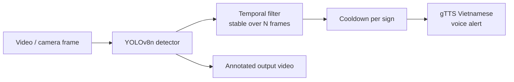

<h1 align="center">🚦 VR-TSD: Vietnamese Traffic Sign Recognition</h1>

<p align="center">
  <b>A Real-World Dataset and a Lightweight YOLOv8n Model for Traffic Sign Recognition in Vietnam</b><br/>
  <i>Published at CSA 2025 – The 17th International Conference on Computer Science and its Applications (Springer)</i>
</p>

<p align="center">
  <a href="https://link.springer.com/chapter/10.1007/978-981-95-7896-2_10"></a>
  <a href="https://drive.google.com/file/d/1JtekjwLvfJC0tHHrWJdlvd40RyeMrAkl/view?usp=drive_link"></a>
  
  
  
</p>

---

## 📌 Overview

Real-time traffic sign recognition is a key component of Advanced Driver Assistance Systems (ADAS) and autonomous vehicles. Most existing work relies on foreign datasets that do not reflect real Vietnamese road conditions, where signs are often **faded, occluded, or captured in poor lighting and bad weather**.

This project introduces **VR-TSD** (Vietnamese Real-world Traffic Sign Dataset) and a lightweight **YOLOv8n** detector, plus a real-time pipeline with **Vietnamese voice alerts** for drivers.

## 📊 Results

| Metric | Value |
|---|---|
| mAP@0.5 | **0.9434** |
| mAP@0.5:0.95 | **0.7567** |
| Speed – NVIDIA A100 | **168.86 FPS** (5.92 ms / image) |
| Speed – iPhone 11 Pro Max | **77.5 FPS** |
| Model size | **~6 MB** |

Both platforms exceed the ~10 FPS typically required for ADAS traffic sign recognition.

## 🗂️ Dataset

- **58** common Vietnamese traffic sign categories
- Real traffic scenes: low light and night, rain, occluded and faded signs, dense urban traffic and national highways
- End-to-end pipeline: collection → preprocessing → manual labeling
- Benchmarked **YOLOv5, YOLOv8 and YOLOv11**; YOLOv8n gave the best accuracy / latency trade-off

## 🔄 Pipeline



The voice module only announces a sign after it has been detected consistently across several frames, and applies a per-sign cooldown to avoid repeated alerts.

## 📁 Project Structure

```
Vietnamese-Traffic-Sign-Detection/
├── main/
│   ├── model/best.pt                               # trained YOLOv8n weights
│   └── src/
│       ├── Vietnamese_Traffic_Signs_Detection.ipynb  # training & evaluation (Colab)
│       └── main_voice.py                           # real-time inference + voice alerts
├── data-test/test_voice.mp4                        # sample test video
└── requirements.txt
```

## 🚀 Quick Start

```bash
git clone https://github.com/LinhNhat07/Vietnamese-Traffic-Sign-Detection.git
cd Vietnamese-Traffic-Sign-Detection
pip install -r requirements.txt
python main/src/main_voice.py
```

The annotated video is saved to `main/results/`. Press `q` to stop. Thresholds, FPS and cooldowns can be changed in the `CONFIG` block at the top of `main_voice.py`.

## 🛠️ Tech Stack

`Python` · `PyTorch` · `Ultralytics YOLOv8` · `OpenCV` · `gTTS` · `pygame` · `Roboflow` · `Google Colab`

## 📄 Citation

If you use this work, please cite the paper:

> **VR-TSD: A Real-World Dataset and a Lightweight YOLOv8n Model for Traffic Sign Recognition in Vietnam.**
> In: *Proceedings of CSA 2025 – The 17th International Conference on Computer Science and its Applications*, Springer.
> DOI: [10.1007/978-981-95-7896-2_10](https://doi.org/10.1007/978-981-95-7896-2_10)

## 👤 Author

**Nguyen Hong Nhat Linh** – AI Engineer · [GitHub](https://github.com/LinhNhat07) · nlinh.nh7@gmail.com
