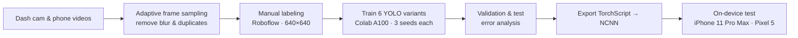
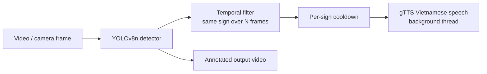

<h1 align="center">🚦 VR-TSD: Vietnamese Traffic Sign Recognition</h1>

<p align="center">
  <b>A Real-World Dataset and a Lightweight YOLOv8n Model for Traffic Sign Recognition in Vietnam</b><br/>
  <i>CSA 2025 – The 17th International Conference on Computer Science and its Applications (Springer)</i><br/>
  <i>+ an extended real-time pipeline with Vietnamese voice alerts</i>
</p>

<p align="center">
  <a href="https://link.springer.com/chapter/10.1007/978-981-95-7896-2_10"></a>
  <a href="https://universe.roboflow.com/vietnam-traffic-sign-recognition-benchmark/vr-tsd"></a>
  <a href="https://drive.google.com/file/d/1JtekjwLvfJC0tHHrWJdlvd40RyeMrAkl/view"></a>
  
  
</p>

---

## 📌 Overview

Real-time traffic sign recognition is a key component of Advanced Driver Assistance Systems (ADAS) and autonomous vehicles. Most existing work relies on foreign datasets (GTSRB, TT100K) or limited Vietnamese datasets that do not reflect real Vietnamese roads, where signs are often **faded, occluded, or captured at night, against backlight or in rain**.

This repository contains two parts:

| Part | Content |
|---|---|
| 📄 **The paper** | The **VR-TSD** dataset (58 classes) and a benchmark of 6 lightweight YOLO models, with **YOLOv8n** selected for edge and mobile deployment |
| 🔊 **Extension (beyond the paper)** | A real-time desktop pipeline that detects signs in video and **announces them in Vietnamese by voice** for the driver |

---

## 📄 Part 1 · The Paper

### Authors
Dinh Nguyen Ngoc, **Linh Nguyen Hong Nhat**, Quy Hoang Van, Ham Nguyen, Huong Bui (corresponding author), Phuong Anh Nguyen.
HUTECH University · HCMC University of Technology and Education · Thuyloi University · Swinburne Vietnam (FPT University)

### My contribution
- **Data:** collected traffic videos and images, sampled frames, removed blurred and duplicate frames, and manually labeled bounding boxes on Roboflow
- **Preprocessing:** standardized the dataset (640×640), shuffled and split it into train / val / test, and checked class and split statistics
- **Training & benchmarking:** trained and tuned the 6 YOLO variants on Colab A100 (3 seeds each) and compared accuracy, speed and model size
- **Evaluation:** validation, held-out testing, per-class analysis and false positive / false negative analysis
- **Voice alert extension:** designed and built the real-time Vietnamese voice alert pipeline (Part 2)
- On-device deployment on smartphones (NCNN) was mainly done by co-authors.

### VR-TSD dataset

| Item | Value |
|---|---|
| Classes | **58** common Vietnamese signs: prohibition, mandatory/guidance and warning |
| Images | **8,078** (train 5,668 · val 1,259 · test 1,151 = 70 / 16 / 14 %) |
| Bounding boxes | **13,016**, manually labeled on Roboflow (1–3 signs per image, up to 5) |
| Sources | Dash cams (Xiaomi 70mai A510, Teyes X5), mobile cameras and video frames, 720p – 4K |
| Conditions | Day, night, backlight, rain, low light, occluded and faded signs; urban, highway and suburban roads |

| Dataset | Classes | Images | Country | Diversity |
|---|---|---|---|---|
| GTSRB | 43 | 51,839 | Germany | Low |
| TT100K | 221 | 100,000 | China | Average |
| **VR-TSD** | **58** | **8,078** | **Vietnam** | **High** (night, backlight, rain, low light) |

📦 Dataset: [universe.roboflow.com/vietnam-traffic-sign-recognition-benchmark/vr-tsd](https://universe.roboflow.com/vietnam-traffic-sign-recognition-benchmark/vr-tsd)

### Method



**Training setup:** NVIDIA A100 40 GB, AdamW, batch 64, imgsz 640, up to 300 epochs with early stopping (patience 30), lr0 = 0.0005, lrf = 0.01. Each model was trained 3 times with different seeds and the results were averaged.

### Results

**Accuracy on the test set**

| Model | Size (MB) | Precision | Recall | mAP@0.5 | mAP@0.5:0.95 |
|---|---|---|---|---|---|
| YOLOv5nu | 5.1 | 0.8650 | 0.9055 | 0.9396 | 0.7423 |
| YOLOv5su | 18 | 0.9244 | 0.8936 | 0.9491 | 0.7682 |
| **YOLOv8n** | **6.0** | **0.9211** | **0.8859** | **0.9434** | **0.7567** |
| YOLOv8s | 22 | 0.9476 | 0.8888 | 0.9530 | 0.7667 |
| YOLO11n | 5.3 | 0.8792 | 0.9074 | 0.9233 | 0.7349 |
| YOLO11s | 19 | 0.9195 | 0.8794 | 0.9536 | 0.7623 |

**Inference speed**

| Model | A100 (FPS) | iPhone 11 Pro Max (FPS) | Google Pixel 5 (FPS) |
|---|---|---|---|
| YOLOv5nu | 165.91 | 75.12 | 16.13 |
| YOLOv5su | 161.77 | 63.69 | 7.63 |
| **YOLOv8n** | **168.86** (5.92 ms) | **77.52** | **16.94** |
| YOLOv8s | 166.38 | 59.52 | 7.09 |
| YOLO11n | 150.41 | 61.73 | 13.89 |
| YOLO11s | 151.10 | 51.55 | 6.49 |

**Why YOLOv8n:** its mAP is within 0.02 of the largest models, but it is 3–4× smaller (6 MB) and the fastest on every device tested. It also exceeds the ~10 FPS real-time requirement for ADAS on both phones.

---

## 🔊 Part 2 · Extension: Real-time Vietnamese Voice Alerts

> This part was developed after the paper and is **not part of the published work**.

A desktop pipeline that turns the detector into a driver assistant: it detects signs in a video stream and **speaks the sign name in Vietnamese**, for example *"Cấm đi ngược chiều"* (no entry) or *"Tốc độ tối đa 50"* (speed limit 50).



- **Stable announcements:** a sign is spoken only after it is detected consistently over several frames, which filters out one-frame false positives.
- **No repeated alerts:** each sign has a cooldown so the same sign is not announced over and over while it stays in view.
- **Non-blocking audio:** speech runs in a background thread, so detection keeps running at the target FPS.
- **Readable output:** each class gets its own color, and the annotated video is saved automatically.
- The model shipped in this repo (`main/model/best.pt`) covers **40 classes**: prohibition, speed limit, warning and guidance signs, each with a Vietnamese voice label.

🎬 [Watch the voice alert demo](https://drive.google.com/file/d/1JtekjwLvfJC0tHHrWJdlvd40RyeMrAkl/view)

### Quick start

```bash
git clone https://github.com/LinhNhat07/VR-TSD-Vietnamese-Traffic-Sign-Recognition.git
cd VR-TSD-Vietnamese-Traffic-Sign-Recognition
pip install -r requirements.txt
python main/src/main_voice.py
```

The annotated video is saved to `main/results/`. Press `q` to stop. Thresholds, FPS, the frame-history length and cooldowns are in the `CONFIG` block at the top of `main_voice.py`. Speech uses gTTS, so an internet connection is required.

---

## 📁 Project Structure

```
VR-TSD-Vietnamese-Traffic-Sign-Recognition/
├── main/
│   ├── model/best.pt                                 # YOLOv8n weights (40 classes, voice pipeline)
│   └── src/
│       ├── Vietnamese_Traffic_Signs_Detection.ipynb  # training & evaluation (Colab)
│       └── main_voice.py                             # real-time inference + voice alerts
├── data-test/test_voice.mp4                          # sample test video
└── requirements.txt
```

## 🛠️ Tech Stack

`Python` · `PyTorch` · `Ultralytics YOLO (v5 / v8 / 11)` · `Roboflow` · `Google Colab (A100)` · `NCNN` · `OpenCV` · `gTTS` · `pygame`

## 🔭 Limitations & Future Work

- Very distant, almost fully occluded, and text-based auxiliary signs are still hard to recognize.
- Add rarer sign types and more adverse weather to the dataset.
- Test on more edge hardware, such as Jetson Nano.
- Offline Vietnamese TTS for the voice module.

## 📄 Citation

```bibtex
@inproceedings{vrtsd2025,
  title     = {VR-TSD: A Real-World Dataset and a Lightweight YOLOv8n Model
               for Traffic Sign Recognition in Vietnam},
  author    = {{Dinh Nguyen Ngoc} and
               {Linh Nguyen Hong Nhat} and
               {Quy Hoang Van} and
               {Ham Nguyen} and
               {Huong Bui} and
               {Phuong Anh Nguyen}},
  booktitle = {The 17th International Conference on Computer Science
               and its Applications (CSA 2025)},
  publisher = {Springer},
  year      = {2025},
  doi       = {10.1007/978-981-95-7896-2_10}
}
```

## 🔗 Links

- 📄 Paper: [Springer](https://link.springer.com/chapter/10.1007/978-981-95-7896-2_10)
- 📦 Dataset: [Roboflow Universe](https://universe.roboflow.com/vietnam-traffic-sign-recognition-benchmark/vr-tsd)
- 💻 Official paper code: [dinhnguyenngoc/Vietnamese-Traffic-Sign-Detection](https://github.com/dinhnguyenngoc/Vietnamese-Traffic-Sign-Detection)

## 👤 Maintainer

**Nguyen Hong Nhat Linh**: co-author of the paper and developer of the voice alert extension · [GitHub](https://github.com/LinhNhat07) · nlinh.nh7@gmail.com
